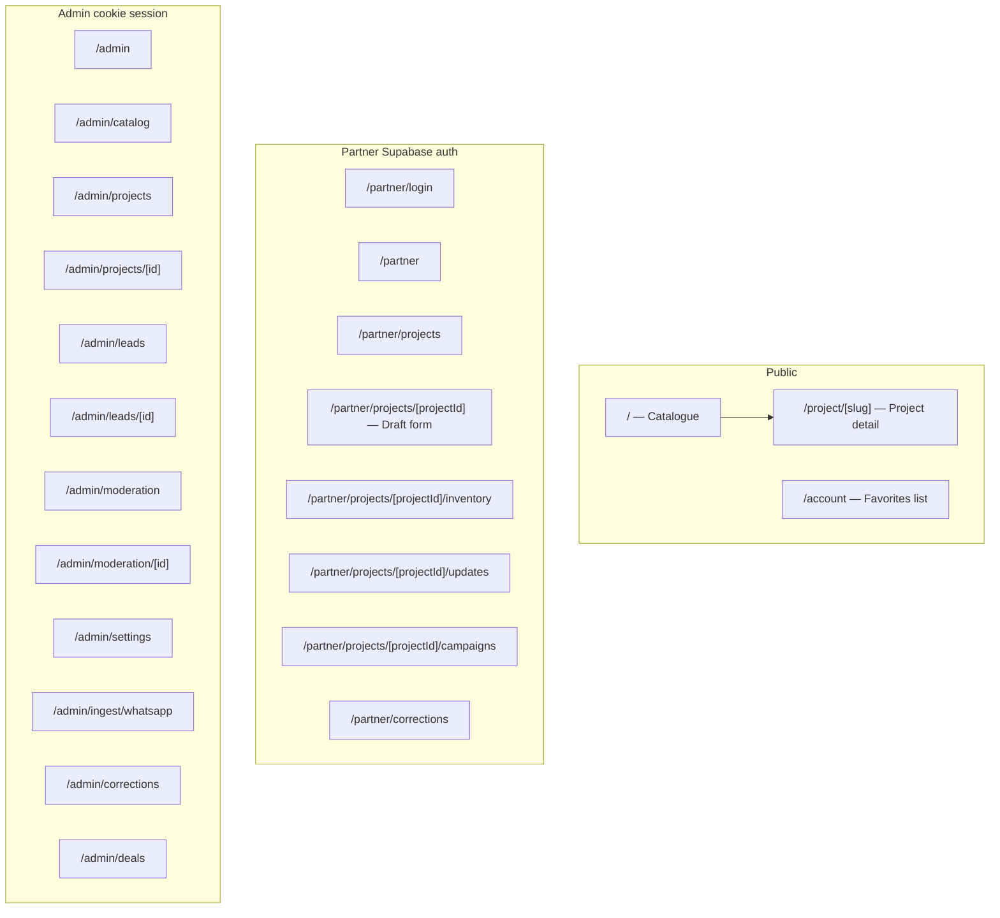

# OFFPLAN (phuket-offplan) — route map and functionality

Dev server: **`http://localhost:3030`** (`npm run dev` in this folder or `npm run dev` from repo root).

Updated 2026-11-04 for main after PR #26–28. This is an overview; a listed route does not certify a production user journey. See README for deployment requirements.

## Route map (App Router)

## What each area does

| Area | Purpose |
|------|--------|
| **/** | Main catalogue (`HomeExperience`): search and project filters, favorites and buyer inquiries; reads published projects and updates through the server data layer. Legacy HTML tabs are not the current homepage. |
| **/project/[slug]** | Single project (`ProjectPage`): verified-date price handling, published unit offers and sales terms, project costs, photos/evidence and updates, buyer inquiry with server-resolved sales selection. Subscriptions store requests; automated update delivery is not configured by this route. |
| **/account** | Logged-in user email + list of favorite `project_id` (UUIDs). |
| **/partner/** | Developer org: create project drafts with a structured wizard, edit existing descriptions, submit moderation and evidence, inventory/import, photos, news/construction updates and campaigns. Access is scoped by organization and partner role; see actions and RLS for each operation. |
| **/admin/** | IE back office: catalog import/settings, projects, leads (unified store + optional AI summary), moderation queue, WhatsApp ingest, corrections, deals, platform settings. Auth via `ADMIN_SECRET` cookie. |

Additional routes: `/partner/projects/new`, project `/facts`, the admin project sales tab, `/admin/readiness`, `/admin/methodology`, `/methodology`, `/quick-assessment`, and `/registry`. ClearView self-check uses the built-in version, while the studio manages separate published versions; commercial orders and monitoring remain unavailable.

## API routes (`app/api`)

| Path | Role |
|------|------|
| `POST /api/analytics/public` | Same-origin product events (`project.view`, etc.) → `analytics_events`. |
| `POST /api/analytics/event` | Server ingest with `ANALYTICS_INGEST_SECRET`. |
| `POST /api/webhooks/stripe` | Stripe signature verify; optional `billing_customers` upsert from Checkout metadata. |
| `POST /api/ai/lead-summary` | Lead summary (admin tooling). |

## Server actions (`app/actions`)

| Module | Main actions |
|--------|----------------|
| `leads.ts` | Public lead submit; admin list/get/update leads. |
| `favorites.ts` | Toggle favorite by legacy project id (logged-in). |
| `project-subscribe.ts` | Subscribe/unsubscribe to project updates (email channel MVP). |
| `partner-marketplace.ts` | Confirm inventory date, CRUD units, project updates, campaigns; audit log side effects. |
| `partner.ts` / `moderation.ts` | Partner draft save, moderation submit; sales blocked from JSON + moderation submit. |
| `admin.ts`, `admin-auth.ts`, `admin-brain.ts` | Admin catalog, settings, AI brain helpers. |

## Data layer (Supabase)

- **orgs**, **profiles** (roles: admin, editor, partner, buyer; `org_id`, `partner_role`).
- **catalog_projects** (payload JSON, moderation, geo, `data_confirmed_at`).
- **project_units**, **sales_campaigns**, **project_updates**, **project_subscriptions**, **favorites**, **leads**, **deals**, **moderation_submissions**, **correction_requests**, **analytics_events**, **org_webhook_endpoints**, **billing_customers**, **catalog_audit_log** (see migrations in `supabase/migrations/`).

Additional domains: `project_evidence` (photos, amenities, costs and sales-stage evidence), `project_sources`, private developer source imports, legal topics, `cv_methodology_versions` and approvals, private request-limit buckets, `project_sales_models` with publication pointers and trusted lead sales snapshots. Public readers use purpose-built views/RLS; an authenticated browser must not query private catalog payloads through a service key.

## Middleware

Non-static routes use Supabase SSR. Middleware forwards refreshed cookies to both the current server request and the browser. Email links return to `/partner`, `/account` or `/registry/review`. Middleware rewrites their one-time code to `/auth/callback` before page authorization, and the server exchanges the code and redirects to the clean URL. Keep the three destination URLs allowed in the Supabase redirect settings. The browser that requested the link must hold its PKCE verifier.

## Cursor / VS Code: preview inside the editor

The embedded preview often lags behind a normal browser for Next.js (HMR, localhost). To open the app **inside Cursor**:

1. Start the dev server (`npm run dev`).
2. **Command Palette** (`Ctrl+Shift+P` / `Cmd+Shift+P`).
3. Run **“Simple Browser: Show”** (VS Code built-in).
4. Enter: **`http://localhost:3030`**

If Simple Browser stays blank, use the external browser for debugging; keep Simple Browser for quick checks. Cursor’s separate **Browser** / MCP tools (if enabled) also accept the same URL.
