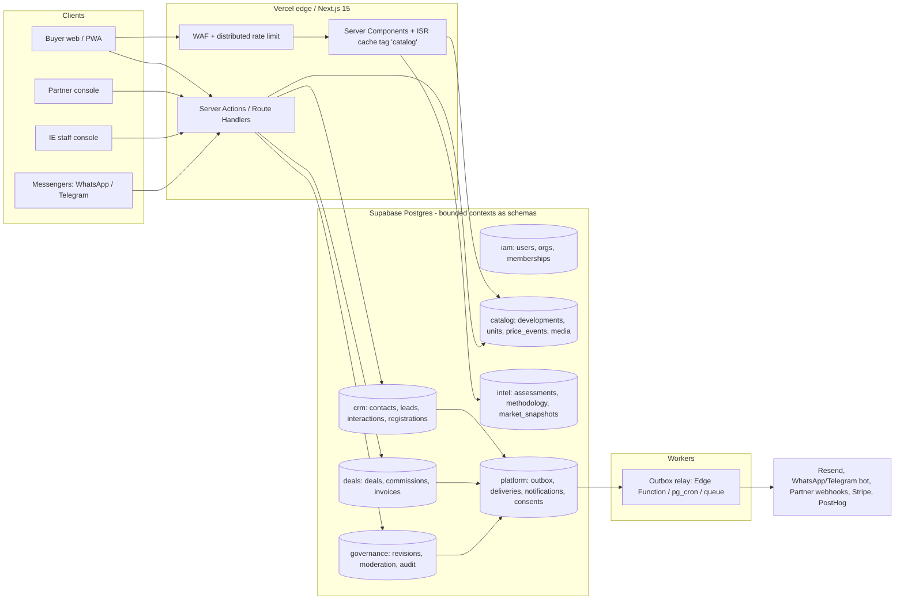

# OFFPLAN — ревью модели данных и архитектуры

> Статус: ревью кодовой базы на коммите `cfb9503` (миграции `20250402…20250409`, `app/`, `lib/`).
> Сопутствующие документы: [`DATA_MODEL.md`](./DATA_MODEL.md) (целевые модели), [`PROCESS_MAP.md`](./PROCESS_MAP.md) (процессы и user journeys).

## 0. Резюме для принятия решений

**Что это за бизнес.** OFFPLAN — не «каталог», а *маркетплейс спроса с атрибуцией*: русскоязычный инвестор → независимая экспертиза (рейтинг/риск) → лид → сделка у застройщика → комиссия. Деньги появляются только в конце цепочки, поэтому ценность платформы определяется четырьмя активами:

| # | Актив | Как защищается | Состояние в коде |
|---|-------|----------------|------------------|
| 1 | Проверенные, структурированные данные об инвентаре и ценах | схема, версии, провенанс | 🔴 один JSON-блоб, строки вида `"฿17.3M"`, `"5–7%"`, `"н/д"` |
| 2 | Независимая редакционная оценка (rat/risk/rec) | отделение от публичных фактов, методология, юр. контроль | 🔴 лежит в том же JSON, публично читается через anon-ключ |
| 3 | Данные о спросе и атрибуция лида → сделки | регистрация лидов, период защиты, журнал | 🔴 лид = одна строка формы; нет контакта, назначения, событий |
| 4 | Комиссионный поток | сделка → начисление → счёт → выплата | 🔴 `deals` — заглушка без связи с застройщиком, суммой сделки и ставкой |

**Главный вывод.** Периметр безопасности (RLS, guard-триггеры, captcha) за последний цикл доведён до приличного уровня. Слабое место теперь *не* в защите, а в **форме данных**: платформа хранит свой главный актив как неструктурированный JSON и не моделирует то, на чём зарабатывает (атрибуция и комиссии). Это решается *до* масштабирования партнёров, пока в базе 122 проекта и нет реальных партнёрских данных: после онбординга первых застройщиков миграция станет в разы дороже.

**Рекомендация:** не переписывать, а выполнить 4 последовательных шага (§5): P0 закрыть утечки → P1 типизировать каталог (expand/contract) → P2 ввести CRM-ядро (Contact/Lead/Registration/Deal/Commission) → P3 надёжная доставка (outbox) и идентифицируемая админка.

---

## 1. Находки по данным (ранжировано)

Условные обозначения: 🔴 критично (риск потери данных/денег/репутации), 🟠 важно (блокирует рост), 🟡 гигиена.

### 1.1 🔴 Публичная утечка непубличных данных через anon-ключ

RLS-политика `catalog_projects_public_read` (`20250404000000_platform_v1.sql`) фильтрует **строки**, но не **колонки**. Anon-ключ публичен (`NEXT_PUBLIC_SUPABASE_ANON_KEY`), значит любой может обратиться к PostgREST напрямую:

```
GET /rest/v1/catalog_projects?select=slug,payload,draft_payload&is_published=eq.true
```

Последствия:

1. **`payload.rec` / `payload.recText`** (BUY/WATCH/AVOID + обоснование) отдаются в обход `toPublicProject()` (`lib/public-catalog.ts`). Механизм «флаг `NEXT_PUBLIC_SHOW_PROJECT_REC` + вырезание на сервере» защищает только UI. Юридически чувствительное мнение остаётся публичным.
2. **`draft_payload`** — незавершённый черновик партнёра (цены, статус, правки до модерации) читается анонимно, как только проект опубликован и у него появился новый черновик.
3. `lat/lng`, `data_confirmed_at` и пр. — безвредны, но показывают, что принцип «колонка = публичная» не соблюдается.

Тест `10_rls_hardening.sql` проверяет только «anon читает опубликованные строки» и не проверяет колонки.

**Решение (корень, а не заплатка):** разделить сущности по *уровню доступа*, а не прятать поля в приложении — публичные факты, редакционная оценка и черновики живут в разных таблицах (см. `DATA_MODEL.md` §3.2–3.3). Быстрая мера до рефакторинга: `revoke select (draft_payload) on catalog_projects from anon, authenticated` + публичный `view` без `rec/recText`, anon читает только view.

### 1.2 🔴 Главный актив — JSON-блоб с «человеческими» строками

`catalog_projects.payload` (31 поле) каноничен, а типизированные колонки лишь `lat/lng/legacy_id`. В данных:

| Поле | Реальное значение | Проблема |
|------|-------------------|----------|
| `pT` / `pN` / `pU` | `"฿17.3M"`, `17.3`, `"$500K"` | цена в трёх видах; нет валюты, нет даты цены, USD-курс зашит в строку |
| `units`, `unitSzM2`, `sqmP` | `"455 (Park Residences phase)"`, `"48–220 sqm"`, `"220,000–350,000"`, `"н/д"` | числа не извлекаются → нельзя посчитать цену за м², диапазоны, фильтр по площади |
| `yield` / `yN` | `"5–7%"` / `6` | диапазон потерян, источник доходности не указан |
| `compY` / `compQ` / `stT` | `2026`, `"Dec 2026 / Q3 2027"`, `"Phase 2 under construction · Dec 2026–Q3 2027"` | дата сдачи — текст; нет «обещанная vs фактическая» → невозможна оценка рисков задержки |
| `dev` + `dt` | `"Amal Group of Companies"` + `"Amal"` | застройщик — **строка**, а не сущность; `org_id` у seed-проектов `null` |
| `src` | `"EdgeProp.sg Nov 2025 · PRC Magazine · Eden-Phuket.com"` | источники одним текстом, нет провенанса на факт |
| `desc`, `recText` | один язык | при `en/ru` UI тексты проекта не локализованы |

Следствия: фильтры и сортировки выполняются в памяти (`lib/filters.ts`), на каждом запросе читаются *все* payload целиком (`getProjects()`), карты/поиск/сравнения/алерты по цене невозможны на уровне БД, а главное — **нельзя строить рыночную аналитику** (динамика цены за м² по районам), т.е. нет потенциального data-moat.

### 1.3 🔴 Комиссионная модель не смоделирована

```
deals(lead_id, project_id, unit_id, status, commission_amount_thb, currency, notes)
leads(…, deal_id)           -- ← обратная ссылка: циклическая пара FK
```

- нет цены сделки, ставки комиссии, условий договора с застройщиком (`commission_rate`, период защиты, триггер выплаты);
- нет `org_id` (кто платит), нет покупателя, нет дат (бронь/договор/оплата), нет статуса *начисления/счёта/выплаты* — а `open|reserved|won|lost|cancelled` смешивает воронку и деньги;
- у лида статусы `new|contacted|qualified|closed|lost`, у сделки `open|reserved|won|lost|cancelled` — `closed` у лида и `won` у сделки не связаны;
- `admin/deals` — только чтение («заполняется из CRM»), записей из приложения нет, `billing_customers` (Stripe) хранит лишь `stripe_customer_id` без планов, инвойсов и прав.

Для маркетплейса с комиссией это ядро P&L. Сейчас невозможно ответить на вопросы «сколько комиссии мы начислили/получили», «какой лид приведён через какого партнёра», «когда истекает защита».

### 1.4 🔴 Атрибуция: партнёр видит контакты лида, платформа не защищена от обхода

`leads_partner_read` + webhook `lead.created` отдают застройщику `name/email/phone` сразу. Это стандартный путь потери комиссии (disintermediation): застройщик закрывает клиента сам. В индустрии это решается **регистрацией клиента с периодом защиты** (registration/protection window, обычно 90–180 дней) и договорным правом на комиссию. В модели нет сущности, которая фиксирует «кто, когда, кому привёл» — единственное доказательство сейчас: строка `leads.created_at`.

### 1.5 🟠 Лид — не человек и не процесс

- нет сущности `contact` (человек): один покупатель, оставивший три заявки, = три несвязанных лида; дедупликации нет (есть индекс по `lower(email)`, но логики нет);
- `leads.user_id` отсутствует → заявка не связана с аккаунтом/избранным/подписками;
- `notes` — одно текстовое поле вместо журнала взаимодействий (звонок, встреча, показ); нет ответственного, SLA, причины потери (`lost_reason`), стоимости привлечения;
- `project_id int` + `project_uuid uuid` + `project_name text` — три представления одной связи; `unit_uuid`, `partner_code`, `deal_id` не используются кодом;
- нет канала предпочтения (WhatsApp/Telegram) — а целевая аудитория общается именно там; поле `phone` по умолчанию `''`.

### 1.6 🟠 Двойная идентичность проекта и «наследие» в схеме

- `legacy_id int` (из HTML-каталога) + `id uuid` + `slug`; весь публичный код (`favorites`, `subscribe`, `leads`, `getProjectByLegacyId`) резолвит `legacy_id → uuid` дополнительным запросом (через service-role).
- Таблицы `projects`, `zones`, `developers`, `catalog_meta` помечены deprecated, но живут (с политиками) и сбивают с толку; `seed.sql` по-прежнему наполняет именно их, а не `catalog_projects`.
- `orgs.code` дублирует `developers.code`; `payload.dt` — третье представление застройщика.

### 1.7 🟠 Модерация и версионирование: три механизма вместо одного

Одна идея «версия контента + решение» реализована трижды:

| Механизм | Что хранит | Чего не хватает |
|----------|-----------|-----------------|
| `catalog_projects.draft_payload` | один текущий черновик | история; параллельные черновики; разделение прав на чтение |
| `moderation_submissions` | `snapshot`/`baseline_snapshot` + решение | полиморфная ссылка `entity_type+entity_id` без FK |
| `catalog_audit_log` | `diff` + `actor_id` | `actor_id` у админов всегда `null` (общий секрет) |
| `catalog_snapshots` | квартальный дамп всего каталога | используется лишь как опция импорта |

Публикация (`approveModerationSubmission`) — 3 отдельных вызова с ручным `revert()` в приложении, т.е. **не атомарна**: падение процесса между шагами оставляет `approved` без обновлённого проекта. Должна быть одна SQL-функция/транзакция.

### 1.8 🟠 Инвентарь: нет истории цены и свежести

`project_units` хранит только текущее состояние. Нет `unit_price_events`: нельзя показать «цена выросла на 8% за квартал», нельзя доказать покупателю/аналитику динамику, нельзя вычислять скорость продаж (absorption rate) — ключевой индикатор риска девелопера. `data_confirmed_at` на проекте — один флаг свежести на весь проект; RLS партнёра на юниты не различает `owner` и `sales` (в коде различается, в БД нет — обход возможен прямым API).

### 1.9 🟠 Коммуникации без потребителя

`project_subscriptions` (email-канал) заполняется, но **ничего не читает её** — при публикации `project_updates` уведомления не отправляются (`grep` по кодовой базе: единственное использование — `project-subscribe.ts`). `analytics_events` — «сырой» лог без retention; `org_webhook_endpoints.secret` хранится открытым текстом; нет таблиц доставки (`webhook_deliveries`), ретрай делается `setTimeout` внутри `after()`.

### 1.10 🟡 Прочее

- `platform_settings.catalog_headline` (в БД) игнорируется: `getCatalogMeta()` жёстко кодирует `quarterLabel: "Q2 2026"`, `totalValueBnTHB: 71` — публичная цифра «стоимость рынка» не вычисляется из данных.
- Таксономии (`lib/taxonomy.ts`, 23 района, enum-ы) живут в коде; в БД их нет → ни FK, ни i18n-подписей, ни добавления района без деплоя. Формат подписей — `*_en/*_ru` колонки (не масштабируется на 3-й язык).
- Нет единиц PII-политики: срок хранения лидов/аналитики, право на удаление (DSAR), журнал согласий (есть лишь `consent_at/version` на лиде).
- Почти все индексы — по `created_at`; нет GIN по `payload`, нет составных индексов под фильтры каталога.

---

## 2. Находки по архитектуре

### 2.1 Что сделано правильно (сохранить)

- **Модульный монолит на Next.js 15 + Supabase.** Для стадии «0 → первые 50 застройщиков» это оптимально; микросервисы добавят сложность без выгоды.
- **Defense in depth для БД:** RLS + `SECURITY DEFINER` хелперы без рекурсии, guard-триггеры против эскалации ролей, тест RLS в CI на чистом Postgres.
- **Лид-пайплайн:** captcha, honeypot, rate-limit, согласие с версией, side-effects через `after()`.
- **Подпись вебхуков** HMAC + timestamp, защита от SSRF по hostname.
- **Деградация:** таймауты чтения, `parseCatalogRows` по строкам (одна плохая строка не роняет каталог).

### 2.2 Проблемы архитектуры

| # | Находка | Серьёзность | Почему важно |
|---|---------|-------------|--------------|
| A1 | **Тихий fallback на seed-JSON в продакшене** (`lib/catalog.ts`: при ошибке БД *или пустом результате* отдаётся `data/seed/projects.json`). Проект, снятый с публикации или отклонённый модерацией, «воскреснет» из seed; устаревшие цены будут показаны как актуальные. | 🔴 | потеря доверия, юр. риск |
| A2 | **Два параллельных контура аутентификации админа:** RLS знает `profiles.role in (admin, editor)`, а админка входит по общему `ADMIN_SECRET` и ходит под service-role (обходит RLS). Нет личности → аудит с `actor_id = null`, нет отзыва доступа, нет MFA. | 🔴 | аудит и разделение обязанностей невозможны |
| A3 | **Побочные эффекты без гарантий доставки:** email, вебхук, аналитика — в `after()` с `Promise.allSettled`; ошибка → `console.error`. Потерянный `lead.created` у партнёра = упущенная сделка. | 🟠 | прямые потери выручки |
| A4 | **Бизнес-операции не транзакционны:** публикация модерации, создание лида + события, `grantCorrectionRequest` — цепочки отдельных запросов с ручным откатом. | 🟠 | полу-применённые состояния |
| A5 | **Чтение каталога = «весь каталог в память»** при каждом запросе главной (нет `unstable_cache`/ISR для данных; `revalidate` есть только у sitemap). На 122 проектах незаметно, на 2000 — латентность и стоимость. | 🟠 | масштаб |
| A6 | **Rate limiting в памяти инстанса** (отмечено в `SECURITY.md`); на serverless — декоративно. | 🟠 | защита лид-формы |
| A7 | **Партнёр редактирует «JSON каталога» в `textarea`** (`project-draft-form.tsx`). Это инструмент разработчика, а не продукт для отдела продаж застройщика; ошибки валидации понятны только инженеру. | 🟠 | конверсия онбординга партнёров |
| A8 | **Нет онбординга партнёра:** вход по magic-link создаёт `buyer`; назначение `role/org_id/partner_role` — ручная правка БД. Нет приглашений, нет верификации компании (KYB). | 🟠 | блокирует масштабирование предложения |
| A9 | **Источник правды размыт:** HTML-вкладки (`content/html-tabs/*.html`), `legacy/catalogue-q2-2026.html`, `data/seed/*.json` и БД одновременно содержат контент аналитики/рисков/девелоперов. | 🟡 | дрейф данных |
| A10 | **Файловое хранилище лидов** (`data/leads.json`) как dev-fallback + `listLeadsUnified` падает на файл, если БД вернула 0 строк — маскирует проблемы конфигурации. | 🟡 | ложные срабатывания в проде |
| A11 | **Stripe-вебхук без модели биллинга** (501 без ключей; пишет лишь `billing_customers`). Бизнес-модель монетизации партнёров не определена, код — задел без ценности. | 🟡 | лишняя сложность сейчас |
| A12 | **Наблюдаемость:** `console.error` вместо структурных логов/метрик/алертов; нет SLO на «лид → доставлен партнёру». | 🟡 | непонятно, когда ломается воронка |

### 2.3 Целевая архитектура (эволюция, не переписывание)



Принципы:

1. **Схемы Postgres как bounded contexts** (`iam`, `catalog`, `intel`, `crm`, `deals`, `platform`) — границы владения данными без микросервисов; RLS и права выдаются на уровне схемы.
2. **Транзакционный outbox**: событие записывается в той же транзакции, что и изменение (`lead.created`, `revision.published`, `unit.price_changed`), воркер доставляет at-least-once с ретраями и журналом `deliveries`. Это единый механизм для email, вебхуков, push, подписок и аналитики.
3. **Публикация = функция БД** (`publish_revision(id)`), а не цепочка запросов приложения.
4. **Чтение каталога через кэш с тегами** (`revalidateTag('catalog')` при публикации); fallback — *последняя удачная версия*, а не seed.
5. **Единая идентичность**: Supabase Auth для всех (покупатель, партнёр, staff); `ADMIN_SECRET` удаляется; для staff — MFA.
6. **Разделение «факт / оценка / черновик»** по таблицам и по политикам доступа (устраняет §1.1 структурно).

---

## 3. Что НЕ делать (осознанные отказы)

| Соблазн | Почему отказ |
|---------|--------------|
| Микросервисы / отдельный CRM-сервис | на этой стадии цена координации выше пользы; схемы Postgres дают нужные границы |
| Собственный CRM-UI «как у Salesforce» | управлять сделками можно в Supabase-админке + 3 экрана; интегрировать внешний CRM (HubSpot/Pipedrive) через outbox позже — когда появится отдел продаж |
| Немедленный биллинг партнёров (Stripe subscriptions) | сначала доказать комиссионную модель; Stripe-код пока не развивать |
| Полностью динамическая схема (EAV) для «любых полей проекта» | возвращает проблему JSON; допустим `attributes jsonb` только для *длинного хвоста* необязательных полей |
| Перенос всего аналитического трафика в Postgres | события просмотров/фильтров — в PostHog; в БД остаются только доменные события |

---

## 4. Карта рисков (до/после)

| Риск | Сейчас | Мера | После |
|------|--------|------|-------|
| Утечка `rec/draft_payload` через REST | реально | публичный view + разделение таблиц | исключено структурно |
| Показ снятого/устаревшего проекта из seed | реально | fallback = last-known-good в проде | исключено |
| Потеря `lead.created` у партнёра | возможна | outbox + журнал доставок + алерт | измеримо (SLO) |
| Потеря комиссии (обход платформы) | не контролируется | registrations + период защиты + договор | контролируется |
| Невозможность аудита действий админа | полная | персональные аккаунты + MFA + audit | аудит |
| Неатомарная публикация | возможна | `publish_revision()` в транзакции | атомарно |
| Дрейф между `payload` и `lat/lng/...` | возможен | типизированная проекция + проверка в CI | нет |

---

## 5. План внедрения

Каждый шаг самодостаточен и выпускается отдельно; миграции по схеме **expand → backfill → switch → contract** (старые колонки удаляются только после переключения чтения).

### P0 — закрыть утечки и опасные поведения (≈ 2–3 дня)

1. Публичный `view public_catalog_projects` без `rec/recText/draft_payload`; `revoke select` на базовые колонки для `anon`; тест RLS на колонки.
2. В продакшене не использовать seed как fallback: возвращать последнюю удачную копию (кэш) либо 503 «обновляем данные»; seed — только `NODE_ENV !== 'production'`.
3. Вынести `approve/reject/grant` модерации в SQL-функции (одна транзакция).
4. Хэшировать/шифровать `org_webhook_endpoints.secret` (Supabase Vault), хранить только показ при создании.
5. `getCatalogMeta`: брать заголовок из `platform_settings`, остальное считать из данных.

### P1 — типизированный каталог и разделение сущностей (≈ 1–2 недели)

1. Таблицы `areas`, `developers`(=`orgs.kind='developer'`), `developments`, `development_facts`/`unit_types`, `price_events` (см. `DATA_MODEL.md`).
2. Backfill из `payload` скриптом с парсингом `pT/yield/sqmP/units` и отчётом об отклонениях (`н/д` → `NULL`).
3. `assessments` (rec/rat/risk) отдельно от фактов; `project_revisions` вместо `draft_payload`+`snapshot`.
4. Структурированные формы партнёра вместо JSON-textarea; JSON остаётся как «режим эксперта» для админов.
5. Фильтры/сортировка — на SQL (индексы под фасеты), пагинация, ISR-кэш с тегами.

### P2 — CRM-ядро и атрибуция (≈ 2–3 недели)

1. `contacts`, `leads` (воронка), `lead_interactions`, `registrations` (атрибуция, период защиты), назначение ответственного, `lost_reason`.
2. `deals`, `deal_commissions` (ставка, статусы начисления/счёта/выплаты), договорные условия по застройщику (`org_agreements`).
3. До раскрытия контактов партнёру — регистрация клиента (в отчёте партнёру маскировать email/phone до подтверждения квалификации — по договору).
4. Каналы WhatsApp/Telegram как первоклассный способ связи (бот → лид).

### P3 — надёжность и управление (≈ 1–2 недели)

1. `outbox_events` + воркер + `webhook_deliveries` + `notifications` (замыкает цикл подписок на обновления).
2. Единая аутентификация staff через Supabase Auth + MFA; удаление `ADMIN_SECRET`; персональный `actor_id` в аудите.
3. Онбординг партнёра: приглашение по email → создание `org` + `membership` → верификация (KYB) → назначение ролей.
4. Распределённый rate-limit (Vercel WAF / Upstash), структурные логи, SLO: «лид доставлен партнёру ≤ 60 сек, p99», «свежесть инвентаря ≤ 30 дней».
5. DSAR/retention: сроки хранения `leads`, `analytics_events`; процедура удаления контакта.

### Критерии готовности (Definition of Done для всей программы)

- Любой публичный ответ API содержит только поля из «публичного» контракта (тест на колонки в CI).
- Любое изменение опубликованных данных имеет автора (`actor_id ≠ null`), версию и откат.
- Для каждого лида можно ответить: кто привёл, кому передан, когда истекает защита, чем закончился.
- Для каждой сделки известны: цена, ставка, начислено, выставлено, получено.
- Потеря процесса в любой момент не оставляет «полу-состояний» (все бизнес-операции транзакционны или идемпотентны через outbox).

---

## 6. Метрики продукта, которые модель должна давать «из коробки»

| Метрика | Источник | Зачем |
|---------|----------|-------|
| Цена за м² по району / динамика | `price_events` + `units` | рыночная аналитика, дифференциатор |
| Скорость продаж (absorption) проекта | `units.status` + история | сигнал риска для рейтинга |
| Свежесть данных проекта | `data_confirmed_at`, `price_events` | доверие, SLA партнёров |
| Конверсия: просмотр → лид → квалификация → сделка | `analytics` + `leads` + `deals` | экономика привлечения |
| Время ответа партнёра на лид | `lead_interactions` | качество предложения, рейтинг партнёров |
| Выручка по комиссиям: начислено/получено/просрочено | `deal_commissions` | P&L |
| Доля сделок через регистрацию (защищённые) | `registrations` | контроль утечки комиссии |
