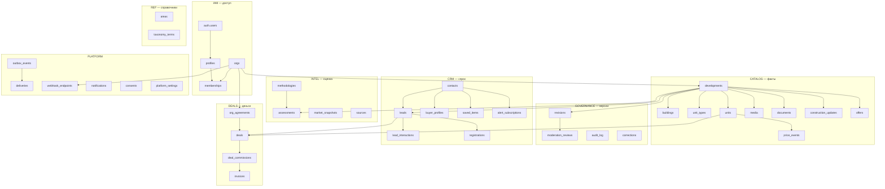
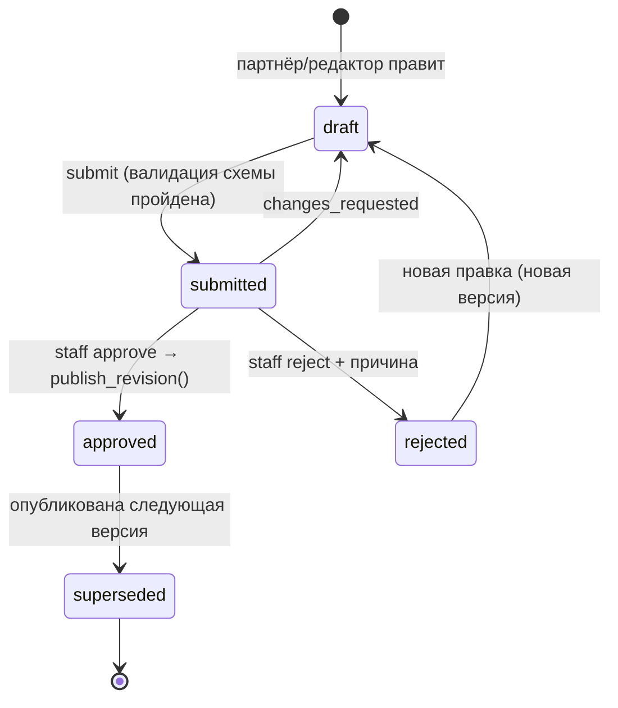
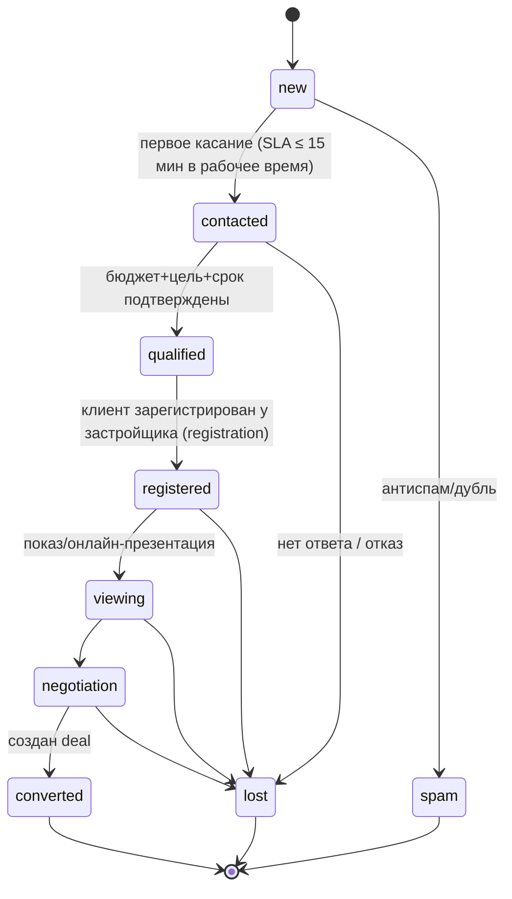
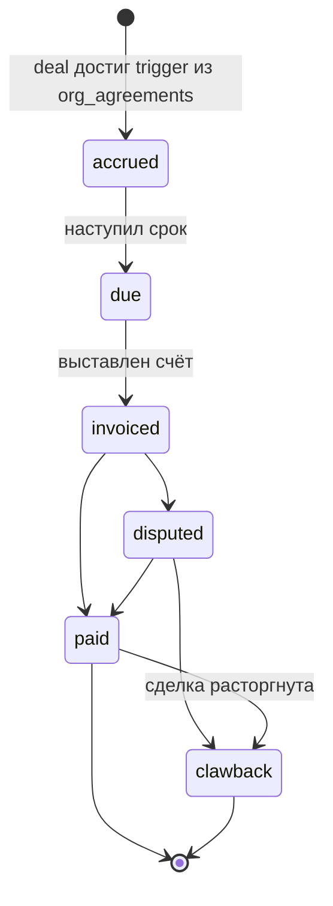

# OFFPLAN — целевая модель данных

> Ревью текущего состояния и обоснование — в [`ARCHITECTURE_REVIEW.md`](./ARCHITECTURE_REVIEW.md).
> Этот документ — **целевая** модель (проектное решение, не миграция): что должно существовать, как называется, какие инварианты. Порядок внедрения — в `ARCHITECTURE_REVIEW.md` §5.

## 1. Принципы моделирования

1. **Один факт — одно место.** Цена, площадь, дата сдачи — типизированные колонки; текст для людей (`"฿17.3M"`) *вычисляется* форматтером.
2. **Разделяем по уровню доступа, а не по удобству.** Публичные факты, редакционные оценки, черновики, персональные данные — разные таблицы, разные политики RLS. Никаких «скрытых полей в публичной строке».
3. **Изменения — события.** Цена, статус юнита, статус лида, статус сделки меняются через append-only журнал; «текущее состояние» — проекция.
4. **Всё внешнее — через сущность-источник.** Данные, пришедшие из WhatsApp/PDF/сайта застройщика, имеют `source` + `captured_at` + `confidence` (провенанс).
5. **Деньги: `numeric(18,2)` + `currency char(3)` + дата курса.** Никаких `numeric` без валюты.
6. **Время:** `timestamptz` везде; «дата сдачи» — `date` + точность (`year|quarter|month|day`), т.к. застройщики называют кварталы.
7. **Локализация:** подписи справочников — `jsonb {"en":…,"ru":…}` (3-й язык без миграции); пользовательский контент — таблица переводов или `jsonb`.
8. **Идентификаторы:** `uuid` как PK, `slug` как публичный стабильный адрес; `legacy_id` только в таблице соответствия на время миграции.
9. **Инварианты в БД, а не в приложении:** `check`, `exclude`, FK, уникальные частичные индексы, триггеры только для сквозных правил.

## 2. Контексты и сущности (карта)



---

## 3. Спецификация по доменам

Формат: **таблица** — назначение; ключевые колонки (PK/FK выделены), инварианты, доступ. Типы `text` с `check` вместо Postgres `enum` (проще эволюционировать).

### 3.1 IAM — личность и принадлежность

| Таблица | Назначение и колонки | Инварианты / доступ |
|---------|----------------------|---------------------|
| `profiles` | 1:1 с `auth.users`. `id` PK=FK, `full_name`, `locale`, `phone`, `created_at`. **Без роли и org.** | Пользователь читает/правит себя. Роль — не здесь. |
| `staff_roles` | Роль сотрудника платформы. `user_id` FK, `role` ∈ `admin\|editor\|analyst\|sales\|finance`, `granted_by`, `granted_at`, `revoked_at`. | Только `admin`; MFA обязателен; запись в аудит. Заменяет `profiles.role in (admin,editor)` и общий `ADMIN_SECRET`. |
| `orgs` | Юрлицо-партнёр. `id`, `kind` ∈ `developer\|agency\|property_manager`, `slug` unique, `legal_name`, `brand_name` jsonb(i18n), `country`, `tax_id`, `website`, `verification_status` ∈ `unverified\|kyb_pending\|verified\|suspended`, `verified_at`. | Публично — только `verified` и только публичные поля (view). Одна компания = одна `orgs`, **она же «застройщик»** (таблица `developers` удаляется). |
| `memberships` | Участие пользователя в организации. `org_id`, `user_id`, `role` ∈ `owner\|sales\|viewer`, `status` ∈ `invited\|active\|removed`, `invited_by`, `invite_token_hash`. PK `(org_id,user_id)`. | Пользователь может состоять в нескольких орг (агент у нескольких застройщиков). Права партнёра = f(membership.role). Заменяет `profiles.org_id + partner_role`. |
| `org_agreements` | Коммерческие условия с орг. `id`, `org_id`, `valid_from`, `valid_to`, `commission_rate numeric(5,4)`, `commission_basis` ∈ `contract_price\|net_price`, `payout_trigger` ∈ `contract_signed\|deposit_paid\|full_payment\|handover`, `protection_days int`, `payout_terms_days`, `currency`, `document_id`. | Видят staff `finance/admin`. Основа для автоматического расчёта комиссий (§3.7). |

### 3.2 REF — справочники

| Таблица | Колонки | Заметки |
|---------|---------|---------|
| `areas` | `id`, `slug`, `parent_id` (регион → район), `name` jsonb, `centroid geography`, `polygon geography`, `sort`, `is_active` | Заменяет `ZONES` в `lib/taxonomy.ts` и `zones`. 23 района — seed. Привязка проекта по `area_id` (FK), не по строке. |
| `taxonomy_terms` | `kind` ∈ `segment\|property_type\|construction_status\|ownership\|management\|investment_focus\|beach_distance`, `code`, `label` jsonb, `sort`, `is_active`. PK `(kind,code)` | Те же коды, что сегодня (`offplan`, `building`, `fh`, `bf`, …), но в БД: подписи на 2+ языках, добавление без деплоя. Приложение кэширует. |

### 3.3 CATALOG — публичные факты

**Ключевое решение:** `payload` разбирается на *факты* (этот домен), *оценку* (§3.5) и *версии* (§3.4).

| Таблица | Колонки | Инварианты / доступ |
|---------|---------|---------------------|
| `developments` | Проект застройки (бывш. `catalog_projects`+`payload`). `id`, `slug` unique, `org_id` FK (застройщик), `name` jsonb, `description` jsonb, `area_id` FK, `location geography(Point)`, `address`, `property_type`, `segment`, `construction_status`, `ownership`, `management`, `beach_distance`, `investment_focus text[]`, `tenure_years`, `launch_date`, `completion_planned date`, `completion_precision` ∈ `year\|quarter\|month\|day`, `completion_forecast date`, `total_units int`, `visibility` ∈ `hidden\|listed`, `published_revision_id` FK, `data_confirmed_at`, `created_at`, `updated_at` | **Публично читается только через view `public_developments`** (без черновиков, внутренних заметок, оценок). `completion_forecast` ≠ `completion_planned` даёт метрику задержки. |
| `buildings` | `development_id`, `name`, `floors`, `completion_planned`, `status` | Для проектов из нескольких корпусов/фаз (напр. «Phase 2 Park Residences»). Не создаётся для однокорпусных. |
| `unit_types` | Типовая планировка. `development_id`, `building_id?`, `code`, `bedrooms`, `bathrooms`, `sqm_min`, `sqm_max`, `price_from`, `price_to`, `currency`, `plan_media_id`, `units_total`, `units_available` | Даёт честные диапазоны вместо `"48–220 sqm"`; источник для карточки и калькулятора. |
| `units` | Конкретная единица. `id`, `development_id`, `building_id?`, `unit_type_id?`, `label`, `floor`, `bedrooms`, `sqm`, `view`, `status` ∈ `available\|reserved\|sold\|withdrawn`, `list_price`, `currency`, `price_per_sqm` (generated), `external_key`, `status_changed_at`, `confirmed_at` | `unique(development_id, external_key)`. Изменение цены/статуса — **только через** запись в `price_events`/триггер журнала. |
| `price_events` | Журнал цен. `id`, `unit_id? / unit_type_id? / development_id`, `kind` ∈ `list\|promo\|sold`, `amount`, `currency`, `effective_at`, `recorded_by`, `source_id` | Append-only. Из него строятся динамика ₽/м², скорость продаж (по `sold`), ценовые алерты. |
| `media` | `id`, `development_id`, `kind` ∈ `render\|photo\|plan\|video\|brochure`, `storage_path`, `alt` jsonb, `sort`, `visibility`, `captured_at` | Заменяет `media_urls jsonb`. Хранилище — Supabase Storage. |
| `documents` | Документы. `development_id`, `kind` ∈ `permit\|title\|contract_template\|payment_plan\|memo\|legal`, `access` ∈ `public\|registered\|staff`, `storage_path`, `mime`, `size`, `valid_to` | Разделение доступа по значению `access`, а не «private bucket для всех» (сейчас `project_documents` — только staff). |
| `construction_updates` | Бывш. `project_updates`. `development_id`, `kind` ∈ `news\|construction\|milestone`, `title/body` jsonb, `media_ids`, `percent_complete numeric`, `published_at`, `created_by` | `percent_complete` + `milestone` дают объективный индикатор прогресса (для рейтинга и подписчиков). |
| `offers` | Бывш. `sales_campaigns`. `development_id`, `kind` ∈ `launch\|promo\|payment_plan`, `title/terms` jsonb, `discount_pct`, `starts_at`, `ends_at`, `is_published` | `check (ends_at is null or ends_at > starts_at)`; `exclude using gist` против пересечения одинаковых акций. |

### 3.4 GOVERNANCE — версии, модерация, аудит

Один механизм вместо `draft_payload` + `moderation_submissions` + `catalog_snapshots`.

| Таблица | Колонки | Инварианты |
|---------|---------|------------|
| `revisions` | Неизменяемая версия данных сущности. `id`, `entity_type` ∈ `development\|org_profile`, `entity_id`, `version int`, `state` ∈ `draft\|submitted\|approved\|rejected\|superseded`, `content jsonb` (структурированный набор полей `developments`+`unit_types`+…), `base_revision_id` (от какой версии правили), `author_id`, `created_at`, `submitted_at` | `unique(entity_type, entity_id, version)`. Не более одного `draft` и одного `submitted` на сущность (частичные уникальные индексы). Содержимое `submitted/approved` **не меняется** (триггер). |
| `moderation_reviews` | Решение по ревизии. `revision_id`, `reviewer_id`, `decision` ∈ `approved\|rejected\|changes_requested`, `note`, `checklist jsonb`, `decided_at` | Только staff. Вызывается из `publish_revision(revision_id)` (одна транзакция: проверка схемы → проекция в `developments`/`unit_types` → `published_revision_id` → событие `revision.published`). |
| `audit_log` | `id`, `actor_type` ∈ `user\|system\|webhook`, `actor_id`, `entity_type`, `entity_id`, `action`, `diff jsonb`, `request_id`, `ip_hash`, `at` | Append-only (ни `update`, ни `delete` даже для `service_role` — через `revoke` + триггер). `actor_id` не null для людей. |
| `corrections` | Запросы на правку данных. `id`, `development_id`, `raised_by_org`, `raised_by_staff`, `field_path`, `message`, `status` ∈ `open\|accepted\|rejected\|closed`, `resolution_revision_id` | Связывает запрос с ревизией, закрывающей его. |

Жизненный цикл ревизии:



### 3.5 INTEL — редакционная оценка и рыночная аналитика

Отделено от фактов — это интеллектуальная собственность и юридически чувствительный контент.

| Таблица | Колонки | Заметки |
|---------|---------|---------|
| `methodologies` | `id`, `version`, `effective_from`, `description` jsonb, `criteria jsonb` (веса: ликвидность, девелопер, локация, продукт), `disclaimer` jsonb, `status` ∈ `draft\|active\|retired` | Заменяет `platform_settings.rating_methodology`. Каждая оценка ссылается на версию — воспроизводимость. |
| `assessments` | `id`, `development_id`, `methodology_id`, `rating numeric(3,1)` (0–10), `risk smallint` (1–3), `label` ∈ `buy\|watch\|avoid`, `rationale` jsonb, `criteria_scores jsonb`, `assessed_by`, `assessed_at`, `valid_until`, `visibility` ∈ `internal\|clients\|public`, `legal_reviewed_at` | **Публичность — данные, а не переменная окружения**: `NEXT_PUBLIC_SHOW_PROJECT_REC` заменяется `visibility` + `legal_reviewed_at is not null`. История оценок хранится (изменение рейтинга = новая строка). Anon не имеет доступа к таблице; публичный view отдаёт только `visibility='public'`. |
| `sources` | Провенанс. `id`, `kind` ∈ `developer_site\|press\|whatsapp\|broker\|site_visit\|public_registry`, `url`, `title`, `captured_at`, `captured_by`, `raw_ref` (напр. ссылка на `ingests`), `reliability` ∈ `A\|B\|C` | Заменяет строку `src`. На `price_events`, `assessments`, `revisions` ссылка по `source_id`. |
| `ingests` | Бывш. `whatsapp_ingests`. `id`, `channel` ∈ `whatsapp\|email\|pdf\|web`, `raw_text`, `parsed jsonb`, `status` ∈ `new\|parsed\|applied\|rejected`, `applied_revision_id`, `created_by` | Связывает «сырьё» с итоговой ревизией — полная цепочка происхождения. |
| `market_snapshots` | Бывш. `catalog_snapshots`. `period` (напр. `2026-Q2`), `scope` (`all` / `area:{slug}`), `metrics jsonb` (медиана ₽/м², число проектов, предложение, средняя доходность), `computed_at` | **Вычисляется из `units/price_events`**, не вводится вручную; публичная цифра «стоимость рынка» перестаёт быть константой `71`. |

### 3.6 CRM — спрос и воронка

| Таблица | Колонки | Инварианты / доступ |
|---------|---------|---------------------|
| `contacts` | Человек (покупатель). `id`, `user_id?` (если зарегистрирован), `full_name`, `email`, `phone`, `messenger` jsonb (`{whatsapp, telegram}`), `preferred_channel`, `locale`, `country`, `source_first`, `created_at`, `merged_into?` | Уникальность по нормализованному email/phone (частичные индексы); слияние дублей — `merged_into`. **PII**: только staff-sales и ответственные; партнёр получает лишь по условиям §3.7. |
| `buyer_profiles` | Намерения. `contact_id`, `budget_min/max`, `currency`, `goal` ∈ `investment\|lifestyle\|relocation\|residency`, `horizon_months`, `financing` ∈ `cash\|installments\|mortgage`, `areas uuid[]`, `property_types`, `notes` | Основа для подбора и приоритизации. Опциональна, наполняется квалификацией. |
| `leads` | Обращение/возможность. `id`, `contact_id`, `development_id?`, `unit_id?`, `kind` ∈ `inquiry\|callback\|viewing\|reservation_intent`, `message`, `source`, `utm jsonb`, `locale`, `status` (см. ниже), `lost_reason`, `owner_id?` (staff), `assigned_org_id?`, `score`, `first_response_at`, `consent_id` FK, `created_at`, `closed_at` | Один человек → много лидов (по проектам). Денормализованные `project_name`, `project_id int` удаляются (JOIN). Антиспам-поля остаются в `raw`/логах. |
| `lead_interactions` | Журнал. `lead_id`, `kind` ∈ `note\|call\|message\|meeting\|viewing\|email\|status_change\|assignment`, `direction`, `body`, `actor_id`, `occurred_at`, `meta jsonb` | Append-only. Из него считаются SLA ответа и касания; заменяет текстовое `notes`. |
| `registrations` | **Атрибуция.** `id`, `lead_id`, `org_id` (застройщик), `development_id`, `registered_at`, `registered_by`, `protected_until` (= `registered_at + org_agreements.protection_days`), `status` ∈ `pending\|accepted\|disputed\|expired`, `accepted_at`, `accepted_ref`, `evidence jsonb` | `exclude using gist (contact_id with =, org_id with =, tstzrange(registered_at, protected_until) with &&)` — нельзя зарегистрировать одного клиента у одного застройщика дважды в окне защиты. Юридическое доказательство первичности. |
| `saved_items` | Бывш. `favorites`. `contact_id` или `user_id`, `development_id`, `created_at`, `list` (shortlist) | Доступно и без регистрации (по токену сессии) → при регистрации сливается в аккаунт. |
| `alert_subscriptions` | Бывш. `project_subscriptions`. `contact_id`, `scope` ∈ `development\|area\|saved_search`, `scope_id/filters jsonb`, `events text[]` (`price_drop`, `new_unit`, `construction_update`, `offer`), `channel` ∈ `email\|whatsapp\|telegram`, `frequency`, `confirmed_at`, `unsubscribed_at` | Реально потребляется outbox-воркером (§3.8). Double opt-in. |

Воронка лида:



`lost_reason` ∈ `no_answer | not_qualified | budget | chose_competitor | project_issue | duplicate | other` — обязательна при `lost`.

### 3.7 DEALS — сделки и деньги

| Таблица | Колонки | Инварианты / доступ |
|---------|---------|---------------------|
| `deals` | `id`, `lead_id` FK, `contact_id`, `org_id` (продавец), `development_id`, `unit_id?`, `registration_id` FK (атрибуция), `status` ∈ `reserved\|contract_signed\|deposit_paid\|paid_in_full\|handed_over\|cancelled\|lost`, `list_price`, `contract_price`, `currency`, `reserved_at`, `contract_signed_at`, `closed_at`, `cancel_reason`, `owner_id` | Статус — **только** воронка продаж. Деньги — в `deal_commissions`. `unique(unit_id) where status not in ('cancelled','lost')` — юнит не продают дважды. Обратной ссылки `leads.deal_id` нет. |
| `deal_commissions` | Обязательство по комиссии. `id`, `deal_id`, `agreement_id`, `rate`, `basis_amount`, `amount`, `currency`, `fx_rate`, `trigger` (из соглашения), `status` ∈ `accrued\|due\|invoiced\|paid\|disputed\|clawback`, `due_date`, `invoiced_at`, `paid_at`, `invoice_id?` | Рассчитывается функцией на основе `org_agreements` при наступлении `trigger`. Возврат (`clawback`) при `deal.cancelled`. Видят `finance/admin`. |
| `invoices` | `id`, `org_id`, `number`, `issued_at`, `due_at`, `amount`, `currency`, `status`, `external_ref` (Stripe/бухгалтерия) | Опционально; Stripe подключается тут, когда подтверждена модель. |
| `payments` | `invoice_id`, `amount`, `received_at`, `method`, `external_ref` | Для сверки. |

Воронка денег (раздельно от продаж):



### 3.8 PLATFORM — надёжность, согласия, настройки

| Таблица | Колонки | Заметки |
|---------|---------|---------|
| `outbox_events` | `id`, `type` (`lead.created`, `revision.published`, `unit.price_changed`, `deal.status_changed`, …), `aggregate_type`, `aggregate_id`, `payload jsonb`, `created_at`, `available_at`, `processed_at`, `attempts`, `last_error` | Пишется **в той же транзакции**, что и доменное изменение. Воркер `FOR UPDATE SKIP LOCKED`. |
| `webhook_endpoints` | Бывш. `org_webhook_endpoints`. `org_id`, `url`, `secret_ref` (Vault), `events text[]`, `is_active`, `created_by` | Секрет не читается обратно, ротация. |
| `webhook_deliveries` | `endpoint_id`, `event_id`, `attempt`, `status_code`, `latency_ms`, `error`, `delivered_at`, `next_retry_at` | Видимость для партнёра и поддержки; экспоненциальный backoff, dead-letter. |
| `notifications` | `id`, `contact_id/user_id`, `channel`, `template`, `payload`, `status`, `sent_at`, `provider_ref` | Единая точка отправки: подписки, ответы лидам, алерты. |
| `consents` | `id`, `contact_id`, `purpose` ∈ `contact_request\|marketing\|cookies`, `version`, `granted_at`, `revoked_at`, `ip_hash`, `evidence` | Заменяет `leads.consent_at/version`. Основа DSAR. |
| `platform_settings` | `key`, `value jsonb`, `updated_by`, `updated_at` | Остаётся для действительно настроек (не для контента методологии). Публичные ключи — whitelist. |
| `analytics` | — | **Не в Postgres.** Просмотры/фильтры — PostHog. В БД остаются лишь доменные события (outbox). `analytics_events` архивируется/удаляется по retention. |

---

## 4. Матрица доступа (RLS-цели)

Колонки — роли; ✔ полный, ◐ ограничено, ✖ нет.

| Сущность | anon | buyer | partner `viewer` | partner `sales` | partner `owner` | staff `editor` | staff `sales` | staff `finance` | staff `admin` |
|----------|:---:|:----:|:---:|:---:|:---:|:---:|:---:|:---:|:---:|
| `public_developments` (view) | ✔ | ✔ | ✔ | ✔ | ✔ | ✔ | ✔ | ✔ | ✔ |
| `developments` (база) | ✖ | ✖ | ◐ своя орг | ◐ | ◐ | ✔ | ✔ | ◐ | ✔ |
| `units`, `price_events` | ◐ view | ◐ | ◐ своя | ✔ своя | ✔ своя | ✔ | ✔ | ◐ | ✔ |
| `revisions` (draft) | ✖ | ✖ | ✖ | ◐ правка | ✔ submit | ✔ | ✖ | ✖ | ✔ |
| `assessments` | ◐ только `public` | ◐ `clients` | ✖ | ✖ | ✖ | ✔ | ◐ | ✖ | ✔ |
| `contacts`, `leads` | ✖ | ◐ свои | ✖ | ◐ маскированные* | ◐ маскированные* | ✖ | ✔ | ◐ агрегаты | ✔ |
| `registrations` | ✖ | ✖ | ✖ | ◐ свои | ✔ свои | ✖ | ✔ | ◐ | ✔ |
| `deals` | ✖ | ✖ | ✖ | ◐ свои | ◐ свои | ✖ | ✔ | ✔ | ✔ |
| `deal_commissions`, `invoices` | ✖ | ✖ | ✖ | ✖ | ◐ свои счета | ✖ | ◐ | ✔ | ✔ |
| `audit_log` | ✖ | ✖ | ✖ | ✖ | ✖ | ◐ | ✖ | ◐ | ✔ (чтение) |
| `outbox_events` | ✖ | ✖ | ✖ | ✖ | ✖ | ✖ | ✖ | ✖ | только service/worker |

\* Маскирование контактов лида для партнёра (`j***@gmail.com`, `+66 ••• ••12`) до момента, определённого `org_agreements` (например, после `registrations.status='accepted'`). Полные контакты — через явную выдачу, фиксируемую в `lead_interactions`.

Правило проверки в CI: для каждой публичной таблицы/view — тест «anon видит ровно перечисленные колонки».

---

## 5. Соответствие «как есть → как будет»

| Сейчас | Проблема | Целевой объект | Действие |
|--------|----------|----------------|----------|
| `projects`, `zones`, `developers`, `catalog_meta` (deprecated) | мёртвые таблицы с политиками | — | удалить после проверки (contract-фаза) |
| `orgs` + `profiles.org_id/role/partner_role` | одна орг на пользователя, роль в профиле | `orgs`, `memberships`, `staff_roles` | миграция ролей; `profiles_guard` упростить |
| `catalog_projects.payload` (31 поле) | JSON-блоб, строки вместо чисел | `developments`, `unit_types`, `assessments`, `sources` | backfill-скрипт с парсером и отчётом отклонений |
| `payload.dev`, `payload.dt` | застройщик — строка | `developments.org_id` → `orgs` | сопоставление по `orgs.code`, создание недостающих `orgs(unverified)` |
| `payload.zone` | строка из enum в коде | `developments.area_id` | FK на `areas` |
| `payload.rec/rat/risk/recText` | публичная утечка, нет истории | `assessments` | вынести; anon-доступ только через `visibility='public'` |
| `payload.pT/pN/pU/yield/units/sqmP/…` | форматированные строки | `unit_types`, `price_events`, `developments.*` | парсинг + ручная очистка `н/д` → `NULL` |
| `catalog_projects.draft_payload` | утечка + одна версия | `revisions(state='draft')` | миграция текущих черновиков |
| `moderation_submissions`, `catalog_snapshots` | дубли версионирования | `revisions`, `moderation_reviews`, `market_snapshots` | перенос истории как `approved/superseded` |
| `catalog_audit_log` | полиморфный, `actor_id` null | `audit_log` | append-only, персональные акторы |
| `correction_requests` | не связан с итоговой правкой | `corrections` | связать с `revision` |
| `project_units` | только текущее состояние | `units`, `unit_types`, `price_events` | триггер пишет события при смене цены/статуса |
| `project_updates`, `sales_campaigns` | `media_urls jsonb`, нет прогресса | `construction_updates`, `offers`, `media` | перенос + `percent_complete` |
| `project_documents` | только staff | `documents(access)` | уровни доступа |
| `whatsapp_ingests` | не связаны с результатом | `ingests` → `revisions` | цепочка происхождения |
| `leads` (+ файл `leads.json`) | нет контакта, журнала, назначения; три формы ссылки на проект | `contacts`, `leads`, `lead_interactions`, `consents` | нормализовать по email; удалить файловое хранилище |
| `deals` | нет цены, ставки, статуса денег, цикл FK | `deals`, `deal_commissions`, `org_agreements`, `registrations` | новые таблицы; `leads.deal_id` удалить |
| `favorites`, `project_subscriptions` | только для авторизованных; подписки без потребителя | `saved_items`, `alert_subscriptions` | подключить outbox-воркер |
| `org_webhook_endpoints` | секрет открытым текстом, нет журнала | `webhook_endpoints`, `webhook_deliveries` | Vault + журнал |
| `analytics_events` | сырой лог без retention | PostHog + доменные события | отключить запись просмотров в БД |
| `billing_customers` | заглушка | `invoices`, `payments` (позже) | заморозить |
| `platform_settings` | методология и заголовок как контент | `methodologies`, `market_snapshots` | вынести, оставить только настройки |

---

## 6. Ключевые решения и компромиссы

| Решение | Альтернатива | Почему выбрано |
|---------|--------------|----------------|
| Типизированные таблицы + `revisions.content jsonb` как *входной формат* версии | Всё в JSONB (как сейчас) | запросы, индексы, аналитика и RLS по колонкам требуют типов; JSON остаётся лишь для неизменяемых снапшотов версий |
| Застройщик = `orgs.kind='developer'` | Отдельная `developers` | одна сущность «компания», один идентификатор для прав, вебхуков и договоров |
| `assessments` отдельной таблицей с `visibility` | Флаг окружения `SHOW_PROJECT_REC` | управляется данными и юристами на уровне записи, а не деплоем; нет утечки через REST |
| `registrations` как отдельная сущность | Поле `partner_code` в лиде | у регистрации собственный жизненный цикл, срок защиты и спор |
| Комиссия отдельно от статуса сделки | Одно поле `status` | сделка может быть «won», а деньги — «disputed»; у них разные владельцы и сроки |
| Outbox в Postgres | Внешняя очередь сразу | транзакционная гарантия бесплатно; воркер — Edge Function/pg_cron; замена на очередь без изменения домена |
| Справочники в БД | Константы в коде | добавление района/подписи без релиза; FK-целостность |
| Для staff — Supabase Auth + MFA | Общий секрет | персональная ответственность, отзыв, аудит |

---

## 7. Минимальный DDL-эскиз ядра (для согласования, не для применения)

```sql
-- Факты о проекте (публичные после публикации через view)
create table catalog.developments (
  id                    uuid primary key default gen_random_uuid(),
  slug                  text not null unique,
  org_id                uuid not null references iam.orgs(id),
  name                  jsonb not null,                       -- {"en":..., "ru":...}
  area_id               uuid not null references ref.areas(id),
  location              geography(point, 4326),
  property_type         text not null,
  segment               text not null,
  construction_status   text not null,
  ownership             text not null check (ownership in ('fh','lh','both')),
  completion_planned    date,
  completion_precision  text check (completion_precision in ('year','quarter','month','day')),
  completion_forecast   date,
  total_units           int  check (total_units > 0),
  visibility            text not null default 'hidden' check (visibility in ('hidden','listed')),
  published_revision_id uuid references governance.revisions(id),
  data_confirmed_at     timestamptz,
  created_at            timestamptz not null default now()
);

-- Атрибуция: один клиент — один застройщик — одно окно защиты
create table crm.registrations (
  id              uuid primary key default gen_random_uuid(),
  lead_id         uuid not null references crm.leads(id),
  contact_id      uuid not null references crm.contacts(id),
  org_id          uuid not null references iam.orgs(id),
  development_id  uuid references catalog.developments(id),
  registered_at   timestamptz not null default now(),
  protected_until timestamptz not null,
  status          text not null default 'pending'
                  check (status in ('pending','accepted','disputed','expired')),
  exclude using gist (
    contact_id with =, org_id with =,
    tstzrange(registered_at, protected_until) with &&
  ) where (status in ('pending','accepted'))
);

-- Комиссия отдельно от воронки сделки
create table deals.deal_commissions (
  id            uuid primary key default gen_random_uuid(),
  deal_id       uuid not null references deals.deals(id),
  agreement_id  uuid not null references iam.org_agreements(id),
  rate          numeric(5,4) not null check (rate between 0 and 1),
  basis_amount  numeric(18,2) not null,
  amount        numeric(18,2) generated always as (round(rate * basis_amount, 2)) stored,
  currency      char(3) not null,
  status        text not null default 'accrued'
                check (status in ('accrued','due','invoiced','paid','disputed','clawback')),
  due_date      date,
  paid_at       timestamptz
);

-- Публичный контракт чтения: только то, что можно показывать анонимно
create view public.public_developments with (security_invoker = false) as
  select d.id, d.slug, d.name, d.area_id, d.property_type, d.segment,
         d.construction_status, d.ownership, d.completion_planned,
         d.completion_precision, d.data_confirmed_at
  from catalog.developments d
  join iam.orgs o on o.id = d.org_id and o.verification_status = 'verified'
  where d.visibility = 'listed' and d.published_revision_id is not null;
```
