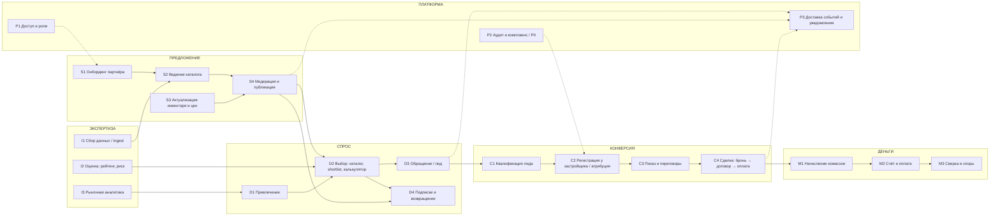
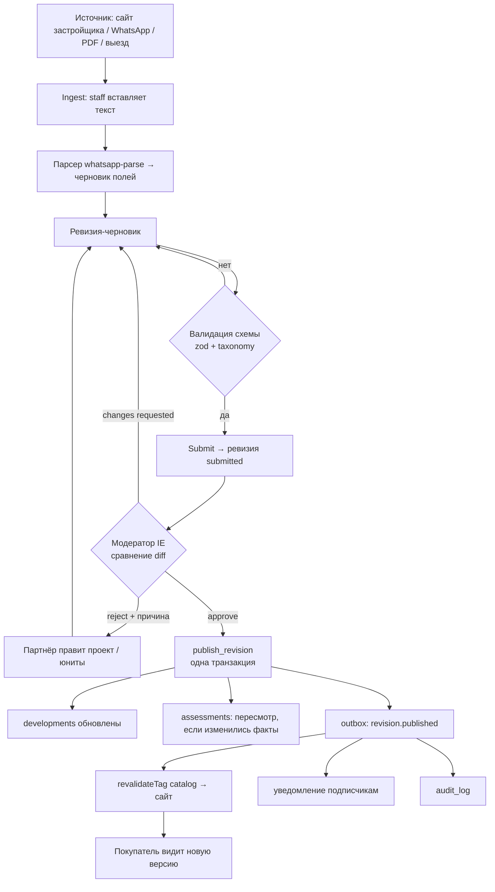
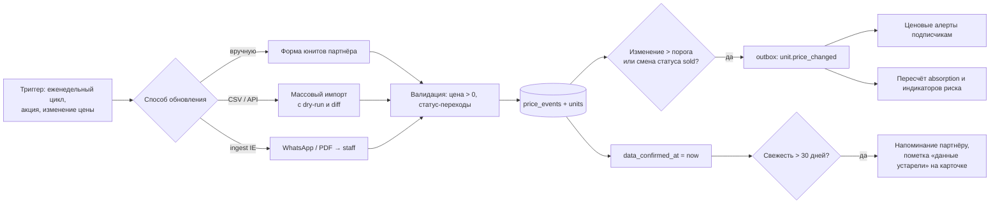
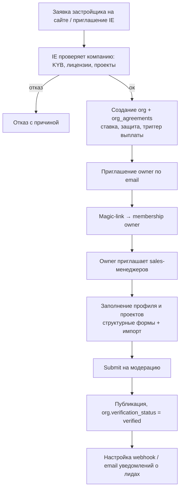
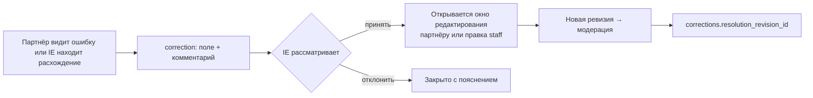
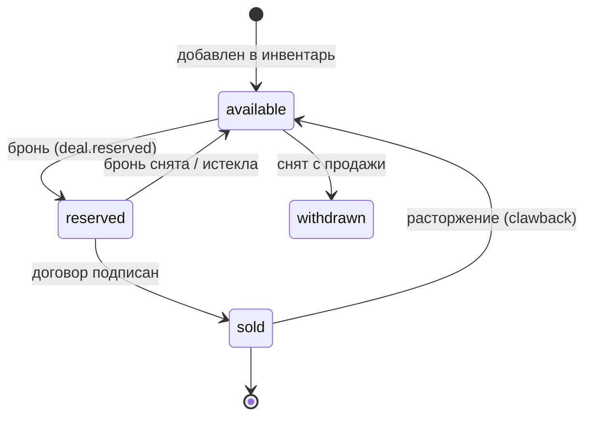

# OFFPLAN — карта процессов и user journeys

> Связано с: [`ARCHITECTURE_REVIEW.md`](./ARCHITECTURE_REVIEW.md), [`DATA_MODEL.md`](./DATA_MODEL.md), [`APP_MAP.md`](./APP_MAP.md) (маршруты).
> Обозначения покрытия кодом: ✅ реализовано · 🟡 частично / вручную · ❌ отсутствует. Оценка сделана по коммиту `cfb9503`.

## 1. Ландшафт процессов (уровень 0)

Платформа — двусторонний маркетплейс с независимой экспертизой. Деньги возникают в конце цепочки; всё остальное — вход в неё.



Покрытие в системе:

| Процесс | Статус | Комментарий |
|---------|:------:|-------------|
| S1 Онбординг партнёра | 🟡 | magic-link есть, назначение `org/role` — ручная правка БД; приглашений и KYB нет |
| S2 Ведение каталога | 🟡 | редактирование «JSON каталога» в textarea; структурных форм нет |
| S3 Актуализация инвентаря | ✅/🟡 | юниты, кампании, апдейты, `confirm data`; нет истории цен, нет массового импорта (CSV/API) |
| S4 Модерация | ✅ | заявка → diff → approve/reject; публикация не атомарна |
| I1 Ingest | 🟡 | вставка WhatsApp-текста + парсер; нет привязки результата к ревизии |
| I2 Оценка | 🟡 | rat/risk/rec лежат в JSON проекта; методология — текст в настройках |
| I3 Рыночная аналитика | ❌ | вкладки — статический HTML; данные не считаются из каталога |
| D1 Привлечение | 🟡 | UTM сохраняются в лид; SEO (`sitemap`, `robots`) есть; каналов (Telegram/WhatsApp) нет |
| D2 Выбор | ✅ | фильтры, shortlist, калькулятор STR, карточка проекта |
| D3 Лид | ✅ | captcha, honeypot, rate-limit, согласие, email, вебхук |
| D4 Подписки | 🟡 | подписка записывается, **рассылки нет** |
| C1 Квалификация | 🟡 | статусы + заметки + AI-стаб; нет скоринга/назначения/SLA |
| C2 Регистрация/атрибуция | ❌ | — |
| C3 Показ/переговоры | ❌ | вне системы |
| C4 Сделка | 🟡 | таблица `deals` только для чтения в админке |
| M1–M3 Комиссии | ❌ | суммы вручную, статусов денег нет |
| P1 Доступ | 🟡 | два контура (Supabase Auth vs общий `ADMIN_SECRET`) |
| P2 Аудит/PII | 🟡 | audit без актора для админа; retention и DSAR нет |
| P3 Доставка | 🟡 | `after()` без гарантий и журнала |

---

## 2. Ключевые процессы (уровень 1)

### 2.1 Жизненный цикл данных каталога (S2 → S4 → D2)

Как данные попадают к покупателю — и где теряется доверие.



**Текущая реализация (как есть):** `A2→A3` — есть; `B2` — поле `draft_payload` (JSON-textarea); `PUB` — три отдельных запроса с ручным откатом; `P2/P3/SUB` — нет; `CACHE` — `revalidatePath` на уровне страниц. Контрольные точки доверия: свежесть (`data_confirmed_at`), провенанс (`sources`), история (`revisions`).

### 2.2 Лид → сделка → комиссия (D3 → C → M) — ядро выручки

```mermaid
sequenceDiagram
  autonumber
  actor B as Покупатель
  participant W as Сайт / бот (Telegram, WhatsApp)
  participant API as Server Action
  participant DB as Postgres
  participant OB as Outbox-воркер
  participant IE as IE Sales
  participant DEV as Застройщик (партнёр)
  participant FIN as IE Finance

  B->>W: заполняет форму / пишет в мессенджер
  W->>API: submitLead(contact, project, consent, utm, captcha)
  API->>API: captcha, honeypot, rate-limit
  API->>DB: TX: upsert contact, insert lead, consent, outbox(lead.created)
  API-->>B: «Принято», ожидаемое время ответа
  OB->>DB: берёт событие (SKIP LOCKED)
  OB->>IE: уведомление + карточка лида (SLA ≤ 15 мин)
  IE->>B: первое касание (канал по предпочтению)
  IE->>DB: lead_interactions, status=contacted
  IE->>B: квалификация (бюджет, цель, срок, финансирование)
  IE->>DB: status=qualified, buyer_profile
  IE->>DEV: регистрация клиента (registration)
  DEV-->>IE: подтверждение, protected_until
  IE->>DB: registrations.accepted, status=registered
  OB->>DEV: webhook lead.registered (контакты по условиям соглашения)
  IE->>B: показ / онлайн-презентация
  B->>DEV: бронь, договор
  DEV-->>IE: подтверждение сделки
  IE->>DB: deal(reserved → contract_signed), привязка registration
  DB->>DB: trigger → deal_commissions(accrued) по org_agreements
  FIN->>DEV: счёт при наступлении trigger (договор/оплата)
  DEV-->>FIN: оплата
  FIN->>DB: commission paid; закрытие
  Note over DB,FIN: при расторжении — clawback; спор → disputed
```

**Текущая реализация:** шаги 1–5 ✅ (без контакта/consent-таблицы), 6–7 ✅ (email/вебхук в `after()`), 8–10 🟡 (статус + заметка), 11–14 ❌ (нет регистрации), 15–19 🟡/❌ (deals без суммы и ставки), 20–23 ❌. Именно этот отрезок формирует выручку и сейчас не защищён и не измеряется.

### 2.3 Актуализация инвентаря и цен (S3)



Сейчас: ручная форма юнитов и кнопка «подтвердить данные» (🟡); истории цен, импорта, алертов, порога свежести нет.

### 2.4 Онбординг партнёра (S1)



Сейчас: ✅ magic-link; ❌ приглашения, KYB, соглашения; 🟡 назначение org/роли — ручная операция в БД (`profiles_guard` пускает только service-role/admin).

### 2.5 Запрос на исправление данных (correction)



Сейчас ✅ в базовом виде (`correction_requests`: open/granted/closed); связи с итоговой правкой нет.

### 2.6 Жизненный цикл юнита



---

## 3. Персоны и user journeys

### 3.1 Персоны

| ID | Персона | Цель | Ключевое опасение | Метрика успеха |
|----|---------|------|-------------------|----------------|
| **B1** | **Инвестор-эмигрант (RU/CIS)**, 35–50, бюджет $150–800K, живёт в Дубае/Тбилиси/Европе | Доходный актив на Пхукете с понятным риском | Обман, задержка сдачи, невыход из сделки, недоверие к рекламе | Сделал shortlist → оставил контакт → встреча → сделка |
| **B2** | **Покупатель для жизни/релокации** | Дом/вилла у моря, ВНЖ | Юридическая чистота, фрихолд vs лизхолд | Консультация, показ |
| **P1** | **Owner застройщика** | Видимость, качественные лиды, контроль данных | Утечка цен, чужие правки, платежи | Лиды в месяц, закрытые сделки |
| **P2** | **Sales-менеджер застройщика** | Быстро обновить статусы, получить лид | Двойная работа, устаревшие данные | Время ответа, свежесть |
| **S1** | **Редактор/аналитик IE** | Достоверный каталог + оценка | Ошибки, юридический риск оценок | Свежесть, число правок без возврата |
| **S2** | **Брокер IE (sales)** | Конвертировать лиды в сделки | Потеря лида, спор о комиссии | Конверсия, время до касания |
| **S3** | **Финансы IE** | Собрать комиссию | Обход платформы, споры | DSO, доля собранной комиссии |
| **S4** | **Админ / владелец** | Рост, контроль, комплаенс | Утечка, неподконтрольные действия | Выручка, SLA, аудит |

### 3.2 Journey B1 — Инвестор: от интереса до сделки

| Этап | Действие | Точка контакта | Боль | Эмоция | Покрытие | Возможность улучшения |
|------|----------|----------------|------|:------:|:--------:|----------------------|
| 1 Осознание | Ищет «новостройки Пхукет доходность» / видит пост в Telegram | Поиск, Telegram/IG канал, сарафан | Много рекламы, нет сравнимых данных | 😐 | 🟡 | Landing по районам и целям, UTM → `source_first`, публичные рыночные индексы (₽/м² по районам) |
| 2 Исследование | Заходит в каталог, фильтрует по району, бюджету, сроку, фрихолду | `/` каталог | Не видит честный риск; текст про цену в разных форматах | 🙂 | ✅ | Типизированные фильтры, карта, сравнение 2–3 проектов, «свежесть данных» на карточке |
| 3 Оценка доходности | Считает STR-доходность в калькуляторе | Вкладка Calc | Допущения не привязаны к рынку | 🙂 | ✅ | Подтянуть бенчмарки района (ADR, occupancy) из `market_snapshots` |
| 4 Доверие | Читает методологию, описание девелопера, историю сдач | Вкладки Risk/Devs/Analytics, `/project/[slug]` | Рекомендации скрыты флагом; нет истории девелопера | 🤔 | 🟡 | Страница застройщика (сданные объекты, задержки), публичные методология и дата оценки, юр. одобренные оценки |
| 5 Shortlist | Сохраняет 3–5 проектов | Избранное | Без регистрации shortlist теряется; нужен аккаунт | 😐 | 🟡 | Shortlist без аккаунта (токен) → merge при регистрации; «поделиться с партнёром» |
| 6 Обращение | Оставляет заявку / пишет в мессенджер | Lead modal, бот | Форма с email+телефон — барьер; хочет WhatsApp/Telegram | 😬 | 🟡 | Мессенджер как основной канал, 2 поля вместо 5, ожидание «ответим за 15 мин» |
| 7 Квалификация | Разговор с брокером: цель, бюджет, срок | Звонок / чат | Брокер повторяет вопросы, не видит историю просмотров | 🙂 | 🟡 | Карточка контакта: shortlist, просмотренные проекты, `buyer_profile` |
| 8 Подбор и показ | Получает 2–3 варианта, смотрит онлайн/выезд | Встреча, видео | Данные в презентации ≠ данные на сайте | 🤔 | ❌ | Подборка из системы со ссылкой и версией данных; календарь показов |
| 9 Решение | Бронь, проверка юр. документов, договор | Застройщик, юрист | Непрозрачные условия, риск задержки | 😟 | ❌ | Чек-лист сделки, документы по уровням доступа, эскроу/юр. партнёры |
| 10 Оплата | График платежей застройщику | Банк, застройщик | Контроль платежей | 😟 | ❌ | Календарь платежей (напоминания) |
| 11 Строительство | Ждёт сдачи | Подписка на проект | Нет вестей, страх задержки | 😟 → 🙂 | 🟡 | Рассылка `construction_updates` (процент готовности, фото); сравнение «план/факт» |
| 12 Сдача и эксплуатация | Приёмка, управление, аренда/перепродажа | — | Уходит из экосистемы | 🙂 | ❌ | Услуги: управление, аренда, перепродажа — повторный доход и данные для реальных доходностей |

**Метрики по шагам:** CR просмотр → shortlist; shortlist → лид; лид → квалифицирован; квалифицирован → показ; показ → бронь; время до первого касания; NPS после сделки.

### 3.3 Journey P1/P2 — Застройщик: от подключения до закрытой сделки

| Этап | Действие | Боль | Покрытие | Улучшение |
|------|----------|------|:--------:|-----------|
| 1 Знакомство | Узнаёт о платформе от IE/коллег; хочет лиды с русскоязычного рынка | Неясна модель оплаты | ❌ | Публичная страница «для застройщиков»: условия, комиссия, SLA |
| 2 Онбординг | Заявка → проверка → договор → приглашение | Всё вручную | 🟡 | Приглашения, KYB-чек-лист, электронный договор, `org_agreements` |
| 3 Первое наполнение | Загружает проект, планировки, цены | JSON-textarea; ошибки схемы непонятны | 🟡 | Мастер из 5 шагов, импорт CSV/Excel/Google Sheet, dry-run с диффом |
| 4 Модерация | Отправляет и ждёт | Нет статуса «где моя заявка» и сроков | 🟡 | Статусы, ETA, комментарии модератора по полям, возврат на доработку |
| 5 Поддержание данных | Раз в неделю обновляет юниты | Забывает → данные устаревают | 🟡 | Напоминания, быстрый апдейт статуса юнита (моб.), API/webhook-синхронизация из CRM застройщика |
| 6 Получение лидов | Вебхук/email, ответ клиенту | Задержки, дубли, нет контекста | 🟡 | Карточка лида с контекстом, SLA-таймер, статусы подтверждения регистрации, отчёт по времени ответа |
| 7 Подтверждение регистрации | Принимает/оспаривает регистрацию клиента | Нет процесса | ❌ | Кнопки Accept/Dispute, срок ответа, авто-принятие по истечении |
| 8 Сделка | Сообщает о брони/договоре | Нет канала | ❌ | Обновление статуса сделки партнёром (с подтверждением IE), выгрузка для сверки |
| 9 Оплата комиссии | Получает счёт | Споры о базе | ❌ | Автоматический расчёт по соглашению, прозрачный реестр сделок |
| 10 Аналитика | Смотрит просмотры, лиды, конверсию | Нет дашборда | ❌ | Партнёрский дашборд: воронка, ответ, сравнение с рынком |

### 3.4 Journey S1 — Редактор/аналитик IE: от сырья до опубликованной оценки

| Этап | Действие | Покрытие | Улучшение |
|------|----------|:--------:|-----------|
| 1 Поступление сырья | Вставляет WhatsApp-сообщение / PDF | 🟡 | Загрузка PDF → извлечение полей (LLM) → предложение ревизии с confidence |
| 2 Сопоставление | Ищет проект, застройщика | 🟡 | Автосопоставление по названию/координатам, дедупликация |
| 3 Правка и источник | Правит поля, указывает источник | 🟡 | Обязательный `source` на изменение факта |
| 4 Модерация | Проверяет заявки партнёров, дифф | ✅ | Дифф по полям, чек-лист, массовое утверждение «безопасных» изменений |
| 5 Оценка | Присваивает rating/risk/label | 🟡 | `assessments` + методология версии, автоподсказка из объективных сигналов (задержка, absorption) |
| 6 Юр. проверка | Согласует публикацию оценок | ❌ | `legal_reviewed_at`, `visibility=public` только после согласования |
| 7 Публикация | Одна кнопка | ✅/🟡 | Атомарная `publish_revision`, инвалидация кэша по тегу |
| 8 Контроль качества | Ищет устаревшие данные | ❌ | Очередь «просроченные проекты» и аномалии цен |

### 3.5 Journey S2 — Брокер IE: ежедневный цикл работы с лидами

| Этап | Действие | Покрытие | Улучшение |
|------|----------|:--------:|-----------|
| 1 Утро | Открывает очередь новых лидов | ✅ | Очередь по приоритету (скоринг, SLA-таймер), назначение |
| 2 Первое касание | Звонит/пишет | 🟡 | Шаблоны ответов на RU/EN, 1-клик в WhatsApp/Telegram, автоматический `lead_interactions` |
| 3 Квалификация | Задаёт вопросы | 🟡 | `buyer_profile` как структурная форма; AI-подсказка по сводке (сейчас заглушка) |
| 4 Подбор | Выбирает проекты | ❌ | Подбор по `buyer_profile` с ранжированием, отправка ссылки на подборку |
| 5 Регистрация клиента | Регистрирует у застройщика | ❌ | `registrations` одним действием; таймер ответа застройщика |
| 6 Сопровождение | Показ, торг, договор | ❌ | Статусы сделки, напоминания, документы |
| 7 Закрытие | Сделка или потеря | 🟡 | Обязательная `lost_reason`, анализ потерь |
| 8 Отчёт | Результаты недели | ❌ | Воронка, время ответа, источники с наибольшей конверсией |

### 3.6 Journey S3 — Финансы: от сделки до денег

| Этап | Действие | Покрытие | Улучшение |
|------|----------|:--------:|-----------|
| 1 Начисление | Видит сделки, достигшие триггера | ❌ | Автоматический расчёт `deal_commissions` по `org_agreements` |
| 2 Счёт | Выставляет счёт застройщику | ❌ | Генерация счёта, `invoices`, отправка по email |
| 3 Контроль | Следит за сроками | ❌ | Просрочки, напоминания, эскалация |
| 4 Споры | Сверка с застройщиком | ❌ | `disputed` + доказательства (`registrations.evidence`, лог касаний) |
| 5 Закрытие периода | Отчёт для бухгалтерии | ❌ | Экспорт, интеграция с учётной системой |

### 3.7 Journey S4 — Админ/владелец: управление и контроль

| Этап | Действие | Покрытие | Улучшение |
|------|----------|:--------:|-----------|
| 1 Доступ | Выдаёт роли, отзывает доступ | 🟡 (общий секрет) | Персональные аккаунты + MFA, `staff_roles` |
| 2 Мониторинг | Состояние воронки и данных | 🟡 | KPI-панель: лиды, SLA, свежесть, комиссия |
| 3 Комплаенс | Запросы на удаление данных, согласия | ❌ | DSAR-процедура, retention-политики, журнал согласий |
| 4 Инциденты | Сбой вебхука / email | ❌ | `webhook_deliveries`, алерты, повторная отправка |

---

## 4. Сквозные «пути данных» (кто пишет → кто читает)

| Данные | Пишет | Читает | Контроль |
|--------|-------|--------|----------|
| Факты проекта | Партнёр / staff через ревизию | Все (публичный view) | модерация, версии, провенанс |
| Оценка (rat/risk/label) | Аналитик IE | по `visibility` | методология, юр. согласование |
| Инвентарь и цены | Партнёр (sales/owner), ingest | Публично (view) | `price_events`, свежесть |
| Контакт и лид | Покупатель (через сервер) | IE sales; партнёр — маскированно | consent, PII-политика |
| Регистрация клиента | Брокер IE | Застройщик, finance | период защиты, спор |
| Сделка | Брокер IE / партнёр с подтверждением | sales, finance, застройщик | статусные переходы |
| Комиссия | Система по соглашению | finance, owner | `deal_commissions`, аудит |
| События/доставка | Outbox | воркер, поддержка | `webhook_deliveries` |

---

## 5. Узкие места процессов и приоритетные действия

| # | Узкое место | Что ломается | Действие | Метрика после |
|---|-------------|--------------|----------|---------------|
| 1 | Нет регистрации/атрибуции (C2) | комиссия не защищена | сущность `registrations` + период защиты | % сделок с регистрацией = 100% |
| 2 | Подписки без рассылок (D4) | нет повторных визитов | outbox-воркер + шаблоны | open-rate, возвраты |
| 3 | Партнёр правит JSON (S2) | медленный онбординг | структурные формы + импорт | time-to-first-publish ≤ 1 дня |
| 4 | Ручной онбординг (S1) | предложение не масштабируется | приглашения, KYB, соглашения | число активных партнёров |
| 5 | Лид без контекста (C1) | низкая конверсия | `contacts`, журнал, `buyer_profile` | CR лид → квалиф. |
| 6 | Доставка в `after()` без журнала (P3) | тихие потери лидов | outbox + `webhook_deliveries` | доставлено ≤ 60 сек, p99 |
| 7 | Админ без личности (P1) | нет аудита | Auth + MFA | 100% действий с `actor_id` |
| 8 | Нет рыночной аналитики (I3) | нет дифференциатора | `price_events` → `market_snapshots` | публичный индекс ₽/м² |
| 9 | Оценки публично читаемы (I2) | юр. риск | `assessments.visibility` | 0 неодобренных публичных оценок |
| 10 | Seed-fallback в проде (S4) | воскрешение снятых проектов | last-known-good | 0 инцидентов устаревших данных |

---

## 6. События домена (контракт между процессами)

Единый словарь для outbox, вебхуков партнёров, аналитики и уведомлений.

| Событие | Когда | Подписчики |
|---------|-------|------------|
| `lead.created` | лид принят | IE sales (уведомление), аналитика |
| `lead.assigned` | назначен ответственный | брокер |
| `lead.qualified` | квалифицирован | подбор, аналитика |
| `registration.created` | клиент зарегистрирован у застройщика | застройщик (webhook), finance |
| `registration.accepted` / `.disputed` / `.expired` | ответ застройщика / срок | брокер, finance |
| `revision.submitted` | партнёр отправил | модераторы |
| `revision.published` | опубликована версия | кэш сайта, подписчики, аналитика |
| `unit.price_changed` / `unit.status_changed` | изменение инвентаря | алерты, `market_snapshots` |
| `construction.update_published` | новость стройки | подписчики |
| `deal.status_changed` | смена статуса сделки | finance, застройщик |
| `commission.accrued` / `.invoiced` / `.paid` | финансовые стадии | finance, владелец |
| `inventory.stale` | свежесть > порога | партнёр (напоминание), модераторы |
